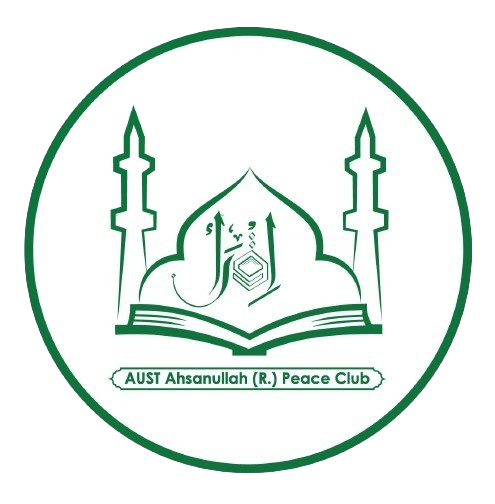

<p align="center">
  
</p>

<h1 align="center">ARPC</h1>

<p align="center">
  <strong>Ahsanullah Roh. Peace Club · AUST</strong><br />
  A campus community brought together by learning, friendship and service.
</p>

<p align="center">
  <a href="https://xgnoir95.github.io/ARPC-Final/">Live website</a> ·
  <a href="docs/ARCHITECTURE.md">Architecture</a> ·
  <a href="docs/DEVELOPMENT.md">Developer guide</a> ·
  <a href=".github/CONTRIBUTING.md">Contributing</a>
</p>

<p align="center">
  <a href="https://github.com/XGNoir95/ARPC-Final/actions/workflows/ci-cd.yml"></a>
  <a href="https://github.com/XGNoir95/ARPC-Final/actions/workflows/codeql.yml"></a>
  
  
</p>

## The website

ARPC's website introduces the club, its people, events and affiliations. The interface pairs forest green and sage with EB Garamond typography, campus photography and responsive layouts.

| Experience | What it includes |
| --- | --- |
| Home | A rotating hero, interactive club introductions, featured events and an affiliation carousel. |
| Panel | Executive committee and team profiles with local portrait placeholders. |
| Gallery | A photo album with page-fold transitions, timed playback, a single compact control bar and a full-image viewer; illustrative photos are clearly labelled. |
| Club reflection | A founder's quotation, expandable reflection and club contact links. |
| Membership | Public Join Us form with validation, application review, database submission, queued confirmation and a downloadable copy. |
| Enrollment | Individual event, webinar and course enrollment pages with programme details, validated student fields, review, database submission, queued receipts and text downloads. |
| Admin workspace | Approved admins manage content, applications, lessons and materials with CRUD, draft publishing and analytics. A superadmin controls access. |
| Learning | Approved course enrollees receive email access links, track lesson progress and download completion certificates. |

**Current scope:** MERN backend for local development, with real admin sessions, superadmin approval, content drafts/publication, database-backed applications, queued confirmation/reset emails, course lessons/materials/progress and PDF certificates. See [Backend setup](Backend/README.md) for first-superadmin, Google OAuth and SMTP configuration. Credentials are blank by default; external email delivery and Google sign-in require your configuration.

Start the API in `Backend` with `npm ci` and `npm run dev:local`; seed drafts with `npm run seed`. Start the frontend separately using the commands below. The backend database persists outside the repository in `~/.arpc/dev-db`.

## Run locally

Use **Node.js 24 LTS** and npm. The supported Node versions are defined in [`Frontend/package.json`](Frontend/package.json); [`.nvmrc`](.nvmrc) selects Node 24.

```sh
git clone https://github.com/XGNoir95/ARPC-Final.git
cd ARPC-Final/Frontend
npm ci
npm run dev
```

Open the local URL printed by Vite. Environment configuration is optional for the default frontend; start from [`Frontend/.env.example`](Frontend/.env.example) when needed.

## Quality checks

Run this from `Frontend` before pushing:

```sh
npm run validate
```

It runs **lint → tests → dependency audit → production build → artifact verification**. CI uses the same checks and installs dependencies from the committed lockfile. CodeQL provides a separate JavaScript security check.

For individual commands, deployment settings and troubleshooting, see the [developer guide](docs/DEVELOPMENT.md).

## Repository layout

```text
ARPC-Final/
├── .github/                 # Workflows, issue forms and contributor policies
├── docs/                    # Architecture and development guidance
├── Frontend/
│   ├── public/              # Club images, local fonts and other static assets
│   ├── scripts/             # Production artifact verification
│   └── src/
│       ├── Components/      # Shared UI and home/profile components
│       ├── Pages/           # Route-level views
│       ├── contexts/        # Shared route-transition state
│       ├── test/            # Test environment setup
│       └── utils/           # Deployment-aware public asset URLs
├── .gitattributes           # Consistent text line endings
├── .gitignore               # Generated files and local configuration
├── .nvmrc                   # Development Node version
└── README.md
```

## Deployment

Successful pushes to `main` deploy to **GitHub Pages** through the [CI/CD workflow](.github/workflows/ci-cd.yml). Pull requests validate changes without deploying them.

The Pages build uses `/ARPC-Final/` as its asset base and hash routing for refresh-safe page links, such as [`#/team`](https://xgnoir95.github.io/ARPC-Final/#/team). The [architecture document](docs/ARCHITECTURE.md) explains this choice and the application's current boundaries.

## Contribute

Use a focused feature branch and a pull request into `main`. Include validation results and, for interface changes, desktop and mobile screenshots. See the [contribution guide](.github/CONTRIBUTING.md).

Report defects through the [issue forms](https://github.com/XGNoir95/ARPC-Final/issues/new/choose). Report security concerns through the [security policy](.github/SECURITY.md).
