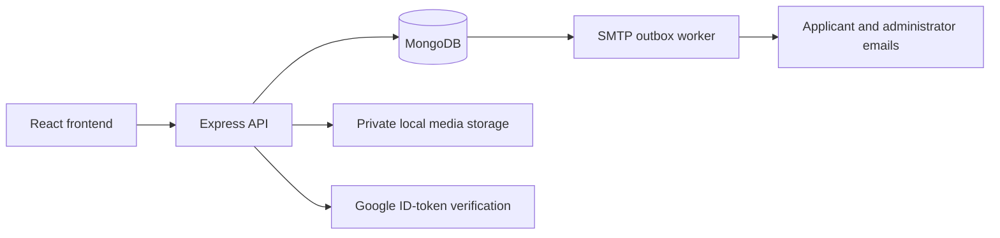

# ARPC architecture

The React/Vite frontend uses Tailwind, EB Garamond, local static assets and the existing shelf, basket, laptop and gallery animations. An Express API uses MongoDB through Mongoose. Full backend setup and endpoint boundaries are in [Backend/README.md](../Backend/README.md).

## Data and access

- Users have an admin/superadmin role, verification flag and pending/active/rejected/suspended status. Only a local bootstrap command creates the first superadmin. Both direct and invited signup remain pending until approved.
- Admin sessions and learner sessions are separate collections/cookies. Random session tokens are hashed at rest; HttpOnly cookies replace browser sessionStorage authentication.
- Content records keep draft and published snapshots with revisions. Public APIs return only published/live content. Saving a draft never changes the public snapshot. Lessons follow the same explicit publication pattern.
- Membership and enrollment forms validate on the server and create applications with email receipts queued in MongoDB. Administrators make decisions and verify payments manually. Membership fees are fixed server-side at BDT 100.
- Approved course enrollment grants email-link access to the learner area. Every lesson/material/progress/certificate endpoint checks current approval for that course. Certificates require all published lessons marked complete.
- Files are stored separately from MongoDB; the database keeps names, types and references. Uploaded PDF learning materials are private. Only referenced, published images are public.
- Analytics stores one aggregate counter per page/date, plus application statistics. The dashboard uses real counts; no synthetic visitors or records are seeded.
- The email worker uses a database outbox, bounded retries and configurable SMTP. Without credentials, messages are queued and explicitly labelled undelivered. Local mailbox inspection is disabled in production.

## Frontend routes

| Route | Behavior |
| --- | --- |
| `/`, `/catalogue`, `/gallery`, `/team` | Existing public layouts with published API content |
| `/join` | Public membership application and manual payment information |
| `/enroll/:kind/:id` | Enrollment form for a published programme |
| `/login`, `/register` | Unlisted admin authentication/request pages, Google or password |
| `/forgot-password`, `/reset-password`, `/verify-email` | Email account recovery and verification |
| `/admin/*` | Server-approved admin workspace or pending-access state |
| `/learn` | Email-link learning area for approved enrollees |
| `/profile` | Legacy illustrative profile component; not an authentication boundary |

Account/admin/learning pages use standalone layouts without public navigation or footer. BrowserRouter and HashRouter are supported; set the backend FRONTEND_URL to include `/#` when using hash links in emails. Route skeleton timing remains capped at two seconds; data requests have explicit loading/error states.

## Local runtime and validation

`Backend/scripts/local.js` downloads a real mongod to the user's cache and starts it with a persistent WiredTiger database. An existing local MongoDB installation or Atlas can be used via MONGODB_URI instead. Seed import is idempotent and all sample records start unpublished.

Backend integration tests run against a separate disposable MongoDB instance, testing account approval, token replay, publication isolation, submissions, material access, progress, certificates and analytics. Frontend tests mock the API at its boundary. Lint, Tailwind policy, build and artifact verification remain mandatory.

Hosting remains a later decision. Local uploaded files and database backups must move to persistent storage before deployment. Use HTTPS and a same-origin API topology so the cookie and Origin policies remain effective. The static GitHub Pages workflow must have an API URL before deployment of this version.
