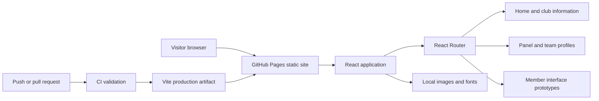

# System architecture

## Purpose and scope

ARPC is a client-rendered website for Ahsanullah Roh. Peace Club at AUST. Its implemented responsibilities are club information, event presentation, team profiles, affiliations and member interface prototypes.

There is no implemented backend, database, session service or certificate generator. Team and profile data are placeholders, and event content is defined in the frontend. This document describes the existing system; future services are explicitly identified as future work.

## Requirements

| Requirement | Current approach |
| --- | --- |
| Present club information across device sizes | React components with responsive Tailwind layouts. |
| Support navigation on a static host | React Router, with hash routing for GitHub Pages. |
| Serve assets under a repository URL | Vite's base setting and the `publicAsset()` helper. |
| Validate changes before deployment | Locked installation, ESLint, Vitest, npm audit, build verification and CodeQL. |
| Keep generated files out of source control | A repository-level `.gitignore`. |

## Components and boundaries

| Component | Responsibility |
| --- | --- |
| `Frontend/src/App.jsx` | Chooses the router, declares routes and coordinates shared navigation/footer visibility. |
| `Frontend/src/Pages/` | Composes route-level screens, including the public membership application and unlisted account prototypes. |
| `Frontend/src/Components/` | Implements reusable UI, carousels, the founder reflection and profile tabs. |
| Route transition context | Shares the previous/current route for transition behavior. |
| `Frontend/src/utils/publicAsset.js` | Prefixes static asset URLs with Vite's deployment base. |
| `Frontend/src/Config/api.js` | Provides an Axios client for a future API; it does not implement a service. |
| `Frontend/public/` | Supplies images, portraits, logos and locally served EB Garamond fonts. |

## Routes and data flow

| Route | Screen | Data source |
| --- | --- | --- |
| `/` | Home | Component content, shared featured events in `src/data/featuredEvents.js`, and the local affiliation array. |
| `/catalogue` | Events, webinars and courses | Sample programmes in `src/data/catalogue.js`. |
| `/team` | Panel | Local sample committee and team member data. |
| `/profile` | Member profile | Sample user, event and certificate data held in component state. |
| `/join` | Membership application | Validated details held in memory, reviewed before an email draft or text download. |
| `/enroll/:kind/:id` | Individual programme enrollment | Selected catalogue or featured event data; validated student details held in memory. |
| `/login` | Unlisted admin login interface | Interface prototype; no authenticated session is established. |
| `/register` | Unlisted admin registration interface | Interface prototype; no account record is created. |

User input and carousel selections update React state. Public assets load from the same static deployment. There is no implemented server-side persistence or API contract to document.

Each programme has an enrollment URL (`kind` is `events`, `webinars` or `courses`). Event and webinar forms require name, student ID, department, semester, gender and email; courses also require mobile number. Shared field definitions and validation live in `src/utils/studentDetails.js`. On desktop, form and programme columns stretch to the same height. Field spacing and the programme image adapt to available space; review uses a compact programme summary. Changing programme IDs resets the form; invalid IDs show a recovery link instead of a form. Review exports identify the selected programme and contain only its required fields. Applicants send an email draft or download a text copy; no place, payment or successful submission is claimed automatically. Archived catalogue entries retain their closed registration actions.

Route changes show the skeleton for at least 1.6 seconds, with a 1.8-second image preparation deadline. The shared 200ms fade-out keeps the entire loader within a two-second maximum, including failed or stalled images. Silhouettes cover every primary section on Home, all panel team rows, the catalogue shelf/basket/laptop, membership and enrollment forms, account/profile layouts, and the combined quote/footer. Skeleton and real content share a grid area so the full silhouette remains in page flow rather than being clipped to a short overlay. Loading content is inert and hidden from assistive technology; navbar navigation remains available. Reduced-motion preferences disable shimmer and shorten transitions.

Public navigation and join actions lead to `/join`, with a photo hero and transparent navbar. The hero and application use the same content alignment. Applications collect name, student ID, one of eight departments, semester (1.1–5.2), gender, email, mobile number, and transaction information for the BDT 100 registration fee. The payment panel matches the member fields' desktop height and switches between method selection and transaction details without resizing. bKash, Nagad and Rocket applicants provide a sender number and transaction ID; bank transfers include the sender bank and transfer reference; cash applicants identify the collecting representative and optionally provide a receipt reference. Switching methods preserves drafts but validates and exports only the chosen method. All payment details remain pending club verification. Confirmed receiving/payment instructions belong in `Frontend/src/data/recruitment.js`; no receiving number is invented or inferred.

Applicants review their entries before opening a draft addressed to the existing club contact (`info@arpc.club`); they must send that email themselves. A text download supports applicants without a configured email app. No application is stored in browser storage, no real payment is initiated, and nothing is claimed to be submitted or paid automatically.

Account routes are intentionally absent from public navigation. They remain directly reachable until backend admin authorization and restricted account provisioning are implemented; unlisted routes are not access controls.

## Deployment flow

The `CI/CD` workflow runs on pull requests, pushes to `main` and manual dispatch:

1. Check out source and select Node.js 24.
2. Run `npm ci`, lint, component/deployment tests and a high-severity dependency audit.
3. Build with `VITE_BASE_PATH=/ARPC-Final/` and `VITE_GITHUB_PAGES=true`.
4. Verify generated HTML/CSS asset URLs and packaged public files.
5. For successful `main` runs, upload the artifact and deploy through GitHub Pages.

CodeQL runs independently on pushes, pull requests and a weekly schedule. Dependabot proposes dependency and Actions updates. Deployment permissions are limited to the deploy job.

## Design decisions

| Decision | Benefit | Tradeoff |
| --- | --- | --- |
| Static frontend deployment | Simple delivery without application server operations. | Member accounts and persistent data require a future service. |
| Hash routing on Pages | Deep links refresh correctly without server rewrite rules. | Production URLs contain `#`. |
| Browser routing during local development | Conventional local URLs. | Both routing modes need deployment tests. |
| Local images and fonts | Deployment does not depend on external placeholder services. | Assets increase the repository and build size. |
| Component-local content and state | Straightforward frontend development. | Content updates require code changes and a new deployment. |

## Operational and security considerations

Keep `package-lock.json` committed so development and CI use the same versions. Fix failing audits rather than bypassing them. A reverted source change can be deployed through the usual pull request workflow; deployment artifacts are retained for three days.

All `VITE_*` configuration is public in the browser bundle. A future backend must enforce authentication, authorization, input validation and data access; frontend visibility alone cannot protect member information. See the [security policy](../.github/SECURITY.md) and [developer guide](DEVELOPMENT.md).

## Future work

Replace sample content with verified club data. Design the backend and its API contracts before connecting real accounts, registrations or certificates. Add integration tests when those flows exist.
