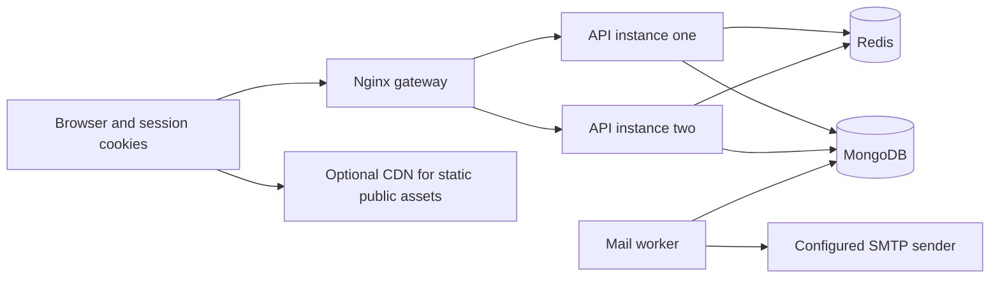

# ARPC authentication and backend system design

Status: Implemented locally with automated integration validation
Scope: Administrator authentication, participant boundaries and optional local scaling infrastructure

## 1 Abstract

ARPC keeps administrator authentication in revocable, hashed server sessions. A shared frontend auth provider checks the server before displaying login, registration or participant forms. Public browsing remains available to admins, with dashboard and logout controls in the navbar. Participant enrollment and learner access reject valid administrator sessions on the server as well as in the UI.

The ordinary local workflow still needs only Node and MongoDB. A separate Docker Compose topology adds an Nginx gateway, two API instances, Redis, shared upload storage and an independent durable mail worker. This is a local scale-testing topology, not a deployed production service.

## 2 Goals and non goals

Goals are reliable authenticated navigation, enforceable administrator boundaries, revocable sessions, shared request protection and recoverable notifications. Redis and extra API instances are optional for single-process development. Production startup requires Redis and an HTTPS frontend URL.

No design can guarantee a flawless backend. The implementation does not provision cloud hosting, TLS certificates or a paid CDN account. Database sharding and multi-region infrastructure remain deferred until workload evidence justifies them.

## 3 Background and problem statement

The existing API already used 256-bit opaque session tokens, password hashing and approval checks. The login page did not check the current session, so signed-in admins could still see the login form. Public application routes also lacked an administrator-session restriction. Local rate counters and mail-worker locks did not coordinate multiple processes.

## 4 Proposed architecture

| Component | Responsibility | Failure behavior |
| --- | --- | --- |
| Shared frontend auth | Server session checks, redirects and cross-tab logout | Participant and auth forms wait for verification; network failures show a retry state |
| Session service | Hashed sessions, absolute and idle expiry, revocation | Invalid or revoked sessions return 401 and clear the cookie |
| API authorization | Approval, role checks and participant boundaries | Protected operations are denied on the server |
| Redis | Distributed rate counters and published-content cache | Rate protection returns 503 during outages; the cache implementation can fall back to MongoDB, while shared API protection intentionally stays closed |
| MongoDB | Source of truth for users, sessions, content, applications, notification intents and mail jobs | Failed writes remain visible as errors; pending application notification intents can reconcile later |
| Mail worker | Atomic job claims, leases, retries and final failure states | Crashed leases recover after two minutes; delivery retries back off and stop after five attempts |
| Nginx | Single origin, least-connection routing, static delivery and proxy timeouts | Failed upstream connections retry another API for eligible requests; mutating requests are not blindly retried |

## 5 Request lifecycle

A login validates credentials, replaces the existing browser session token and stores only its SHA-256 digest. Session cookies are HttpOnly and SameSite=Lax, with Secure enabled in production. Every authenticated API request checks expiry and the current account status against MongoDB. Admin operations additionally require an approved, verified admin or superadmin role.

Session activity is updated at most every five minutes. Idle expiry defaults to 12 hours, absolute expiry to seven days, and active device records are capped at five per account. Password resets and superadmin suspension revoke sessions. Public forms cannot rely on a browser flag to bypass these checks.

Google identity tokens are verified against the configured client audience. A ten-minute browser-bound nonce must match the signed token and be consumed once. Reopening the Google widget reuses a still-valid challenge, so another tab does not immediately invalidate it. Google identity verification never grants administrator approval by itself.

Application creation records a pending confirmation intent before queuing its receipt. Reviews record a notification version. Idempotent outbox keys let the worker reconcile interrupted enqueue operations without creating duplicate jobs. Existing historical records are not automatically resent by this new reconciliation mechanism.

## 6 API and data contracts

| API | Contract |
| --- | --- |
| GET /api/auth/me | Returns the current safe profile, or 401 |
| GET /api/auth/sessions | Lists the caller’s devices without token hashes or token values |
| DELETE /api/auth/sessions/:id | Revokes only a session belonging to the caller |
| POST /api/auth/logout | Revokes the current browser session |
| POST /api/auth/logout-all | Revokes every administrator session for this account |
| GET /api/auth/google-challenge | Issues or reuses a short-lived nonce in this browser |
| POST /api/applications | Validates participant details; rejects valid admin sessions |
| /api/learning/* | Participant access only, with approved-course checks |
| GET /api/health/live | Process liveness, independent of Redis protection |
| GET /api/health/ready | MongoDB, Redis and shutdown readiness |

Existing programme, lesson, media, approval and application routes remain in src/app.js. Their validation contracts remain in src/validation.js. Cookie values and credentials must never be included in logs, analytics or response payloads.

## 7 Consistency idempotency and replay

Content and lesson edits retain optimistic revision checks and publication snapshots. The published-content cache key comes from current MongoDB publication IDs and revisions on every read, preventing old cache fills or Redis recovery from resurrecting withdrawn entries. Private sessions, applications, learning data and uploaded API assets are not CDN cached.

Mail-job claims use atomic MongoDB updates with a unique lease identifier. Completion updates require the same lease. Notification event keys are unique. SMTP delivery remains at least once: a crash after SMTP acceptance but before marking a job sent may duplicate an email. A stable Message-ID helps providers recognise retries but cannot guarantee deduplication.

Application reviews use a revision supplied by the current frontend and an atomic compare-and-update; stale reviews return 409 rather than overwrite another decision. Older API callers without a revision retain a server-side compare-and-update for compatibility. Notification enqueue recovery is durable, but database availability is still necessary to accept a form or review.

## 8 Security and privacy considerations

Passwords use salted scrypt. Tokens use cryptographic randomness and hashed storage. Password signup verifies email with a six-digit random code, stored as a salted scrypt hash, bound to the authenticated account, and consumed once within 10 minutes. MongoDB atomically limits guesses across resends and enforces resend cooldowns and hourly send limits. Outstanding legacy verification links and reset links retain expiry and single-use enforcement. New administrators remain pending until approved by the superadmin. Uploaded content has size and type checks, and course resources require learner authorization. See [email verification details](email-design.md#email-verification-codes).

CORS permits the configured frontend origin. Mutations require the application header, enforce the origin when supplied and reject cross-site Fetch Metadata. A fixed trusted proxy hop count is explicit; direct local access defaults to zero. The gateway overwrites forwarding headers instead of accepting client-supplied addresses.

Redis counter failure does not silently disable protection. Production secrets stay outside images. The local Compose database and Redis are not published to host ports. The HTTP development gateway binds only to localhost. Production requires TLS, authenticated database/cache services, trusted network boundaries and secret management.

## 9 Operational readiness

Run frontend lint, tests, build and artifact verification; run backend syntax checks, MongoDB integration tests and Redis integration tests. Test login through the gateway, subsequent requests across API instances, revocation and loss of one API instance. Test restoring a database backup before production use.

Health checks distinguish a running process from a usable API. Optional request logs include a request ID, method, status and duration without URLs, query tokens, passwords or personal form details. Failed mail jobs are visible in the admin dashboard and can be retried by the superadmin.

MongoDB, Redis and the gateway in the local stack are single instances. Multiple APIs improve API process availability; they do not make this one-machine stack highly available. No latency or availability SLO is claimed without measurements and a hosting plan.

## 10 Alternatives considered

Opaque cookie sessions provide immediate revocation and fit a browser-based admin panel. Extra browser-stored JWT access and refresh tokens would add lifecycle complexity without a present requirement. The durable MongoDB outbox keeps queue state with club data; adding Redis as another durable mail source is unnecessary for this workload.

A single API remains sufficient for ordinary local development. The optional scale topology proves cross-instance sessions and limits. MongoDB sharding distributes large datasets and high-throughput workloads, but adds routers, configuration servers and replica sets. Consider it only after indexed query optimisation and replica-set sizing no longer meet measured demand.

## 11 Open questions

Production hosting, the TLS domain, CDN provider, database replication, backup retention, alert ownership and actual traffic targets remain to be selected. Any later change to cookie cross-site requirements must be reviewed together with CORS and CSRF policy. If a load balancer is added in front of Nginx, configure a trusted real-client-IP chain instead of counting every visitor as the external proxy.

## 12 Decision and next steps

Use the existing local Node/MongoDB workflow now. Enable Redis and the gateway for local scale tests or production preparation. Read infra/README.md for commands and configuration. Add cloud services only after their credentials, domains and operational ownership are chosen. A sharded cluster is not provisioned by this change.

References: [Google identity verification](https://developers.google.com/identity/gsi/web/guides/verify-google-id-token), [Google button and nonce options](https://developers.google.com/identity/gsi/web/reference/js-reference), [Redis client](https://redis.io/docs/latest/develop/clients/nodejs/connect/), [Redis rate-limit store](https://github.com/express-rate-limit/rate-limit-redis), [Nginx upstream routing](https://nginx.org/en/docs/http/ngx_http_upstream_module.html), [MongoDB sharding](https://www.mongodb.com/docs/manual/sharding/).
